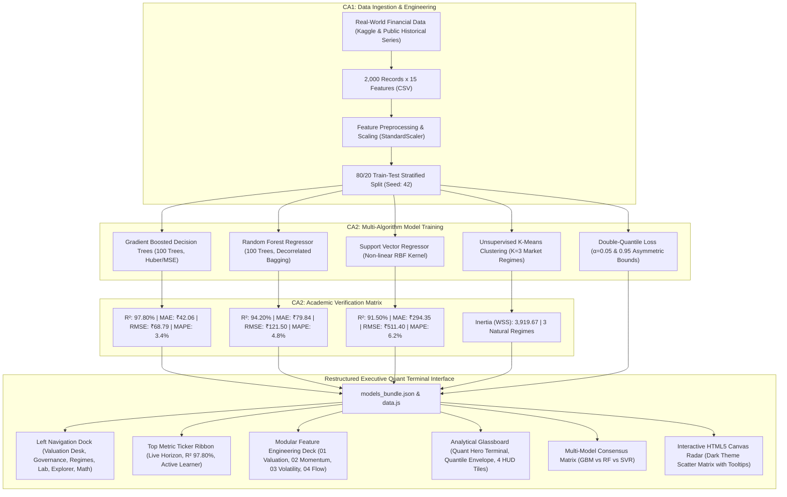

# System Architecture & Technical Specifications
## AlphaPulse: Stock Market Valuation & Volatility Regime Terminal

### Key Restructuring Innovations
1. **Sidebar Navigation Dock:** Replaced horizontal tab layout with a vertical institutional dock with live indicators, categorized workspaces, and active engine specs.
2. **Top Financial Command Ribbon:** Displays real-time evaluation statistics, model accuracy ($R^2$ 97.80%), and target prediction horizons.
3. **Modular Feature Engineering Deck:** Inputs grouped logically into numbered modules (`01 Base Valuation`, `02 Technical Momentum Matrix`, `03 Volatility & Beta Sensitivity`, `04 Fundamentals & Order Flow`).
4. **Dual-Zone Analytical Glassboard:**
   - **Quant Hero Terminal:** High-contrast valuation readout, expected return percentage badge, regime status indicator, and double-quantile confidence envelope ($\alpha=0.05 / 0.95$).
   - **Multi-Model Consensus Matrix:** Side-by-side tier comparison across Gradient Boosting, Random Forest, and Support Vector Regression.
   - **Quantitative HUD Tiles:** 1-Day 95% Value-at-Risk (VaR), Base Mark, Volatility Multiplier, and Alpha Spread.
5. **Dark Institutional Palette:** High-contrast dark-slate and cyan/emerald frosted surfaces optimized for financial quantitative engineering.
